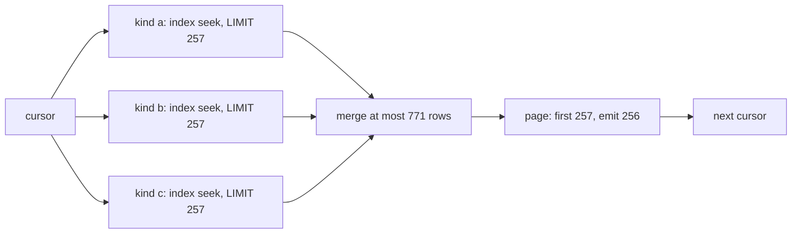

# Session replay performance

Status: measured 2026-11-06 on a 1.9M-row store. Scope: the session read path
(`internal/tasks/session_state_rebuild.go`, `internal/lifecycle/projection`) and
the durable runtime that serves it.

## Workload

- 1.9M journal rows, ~450k occurrence evidence rows, 988 sessions.
- A page is at most `provenance.MaxFactPageSize` rows (256).
- A replay is one page loop; a read applies the suffix after
  `completed_through_jid`.

## Costs and fixes

| Cost | Cause | Fix | Before | After |
|---|---|---|---|---|
| Page query | a multi-kind `IN` cannot stream in `journal_id` order, so SQLite added a temp B-tree and consumed the remaining range per page | one `UNION ALL` branch per kind, each with its own `LIMIT` | 1049 ms at cursor 0 | 7.4 ms, flat |
| Page join | `journal_attributed` is a view over the whole journal, materialized per page | inline the view: join `journal` and `COALESCE(journal.actor_id, anchor.actor_id)` | 6.25 s/page | 0.2-1.2 s/page |
| Kind guard | led with `journal_id`, so it scanned the primary-key range and tested a GLOB per row | lead with `evidence_kind` and the known-kind `NOT IN`; use the covering index | 402 ms at cursor 0 | 41 ms, flat |
| Publication fence | compared the whole cache status, and every write bumps `revision` | compare only what a publication changes: `completed_through_jid` and `cache_version` | retry loop (87 min observed) | publishes under load |
| Definition refs | each v3 row resolved four refs (evidence + committed + state) | a page-scoped set keyed by `(kind, four typed refs, contract)` | 39.7 ms/row | 1.0 ms/row |

Measured definition work for 20 pages / 5,120 rows: 40,980 evidence and 20,480
committed queries before; 180 and 80 after.

## Page shape

The first N rows of a union of ordered streams are contained in the first N of
each stream, so the page and its cursor are identical to a full scan.

## Invariants

- **One pinned snapshot per scan.** `scanSessionReplay` pins the first resolved
  `SnapshotMaxJournalID` and passes it on every page. Rows at or below it are
  immutable; newer rows are the next suffix refresh's work.
- **The publication fence guards publications.** `publishSessionReplay` compares
  `cache_version` and `completed_through_jid`, not `revision` or `dirty`.
  Ordinary writes must not invalidate a pinned scan.
- **A publication clears `dirty`.** A marker that appears during the scan refers
  to a write inside the scanned range; a marker that predates the scan forces a
  full rebuild (`start.Dirty` selects it).
- **The ref set is complete by construction.** Admission reads the evidence
  kind, the four typed definition refs (including `Runtime.Contract`) and the
  payload contract. `HostVersion`, `HostVersionSource` and `Origin` are
  provenance-only. A new definition version is a different ref, hence a
  different key.
- **The ref set is page-scoped.** It is created by `ReadOccurrenceFactPage` and
  dies with the page. It is not a cross-page or cross-scan cache.

## How to measure

- Rebuild and time: `pasture rebuild session` (unbounded; exits on completion).
  `--full` discards the cache and replays the whole journal.
- Serve-time rebuild: `pasture serve --backfill`.
- Query plan: `EXPLAIN QUERY PLAN` for the page statement; the candidates branch
  must show one index seek per kind and no temp B-tree over the range.
- Definition work: wrap the transaction reader in a counting
  `receipt.DefinitionReader`; `LookupCommitted` is called once per resolved ref
  set, so two rows sharing a ref set must produce four calls, not eight. The
  committed test is `TestOccurrenceFactPageResolvesOneDecisionPerDistinctRefSet`.
- Write lane: `make test-performance` (the acceptance row and the load harness).

Measure on a restored copy of the store, read-only. Do not measure against the
live store while the daemon serves it.

## Known remaining costs

- Per-row replay is ~1.0 ms after the ref set. The remainder is payload decode,
  digest verification and transition replay, not definition resolution.
- A large backlog (thousands of rows) exceeds the 30 s implicit read bound. Use
  `pasture rebuild session`; the read path stays coherent but behind.
- The full projection rebuild (`rebuild.go`) still resolves definitions per row
  by design; it is a one-off maintenance path.

## References

- Issues 253, 259, 263, 264, 266, 269.
- `docs/dbos-architecture.md` for the durable runtime.
- `internal/lifecycle/projection/occurrence_validation_set.go` for the key proof.
